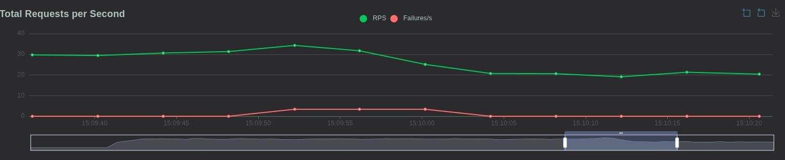
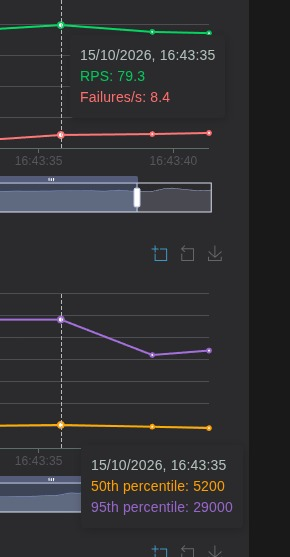

# Informe Rendimiento
## Tabla Comparativa de Resultados 
| Fase | Servidor / Arquitectura | Limite CPU | Usuarios Concurrentes | RPS Logrados | Latencia P95 (ms) | % Errores |
| --- | --- | --- | --- | --- | --- | --- | 
| Fase 1 | app.py | 0.20 | 50 | 15.8 | 4600 | 2.4 |
| Fase 2 | app.py | 0.20 | 50 | 31.3 | 6500 | 1.8 |
| Fase 3 | nginx + 3 replicas | 0.20 | 150 | 34.3 | 7000 | 3.4 |

## Capturas de pantalla 1

## Análisis Técnico 
Un servidor multiproceso soporta más tráfico gracias al redireccionamiento de Nginx, ya que balancea las peticiones de acuerdo con los servidores disponibles. Esto hace que cada uno consuma menos recursos en comparación con tener un solo servidor uniproceso gestionando múltiples solicitudes, el cual debe encargarse de todas por sí solo en lugar de repartirlas equitativamente entre los demás servidores.

# Registro de observaciones 
## Fase 1

## Fase 2 
| Fase | RPS | Tasa de errores | 
| --- | --- | --- |
| Fase 1 | 15.8 | 2.4 |
| Fase 2 | 31.3 | 1.8 |

## Fase 3 

Al apagar una de las 3 máquinas, se generaron 34 errores (HTTP 502) porque un pequeño grupo de peticiones fue enviado a la máquina que justo se estaba apagando. Una vez que el sistema notó la caída, repartió automáticamente todo el tráfico de los 150 usuarios entre las 2 máquinas restantes, lo que hizo que cada una trabajara más de la cuenta, procesando más peticiones por segundo y aumentando su consumo de procesador y memoria. 